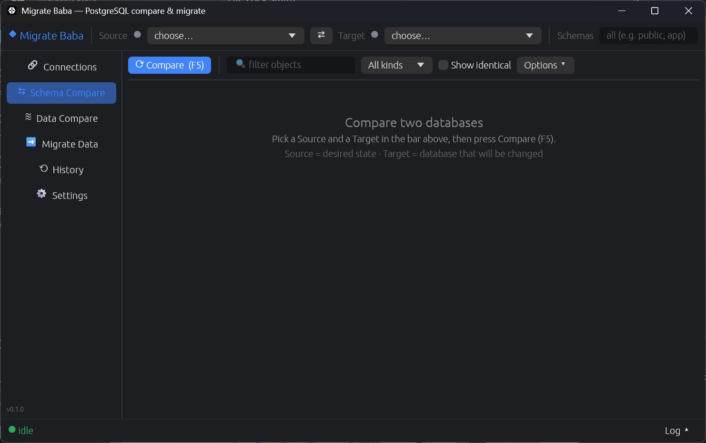
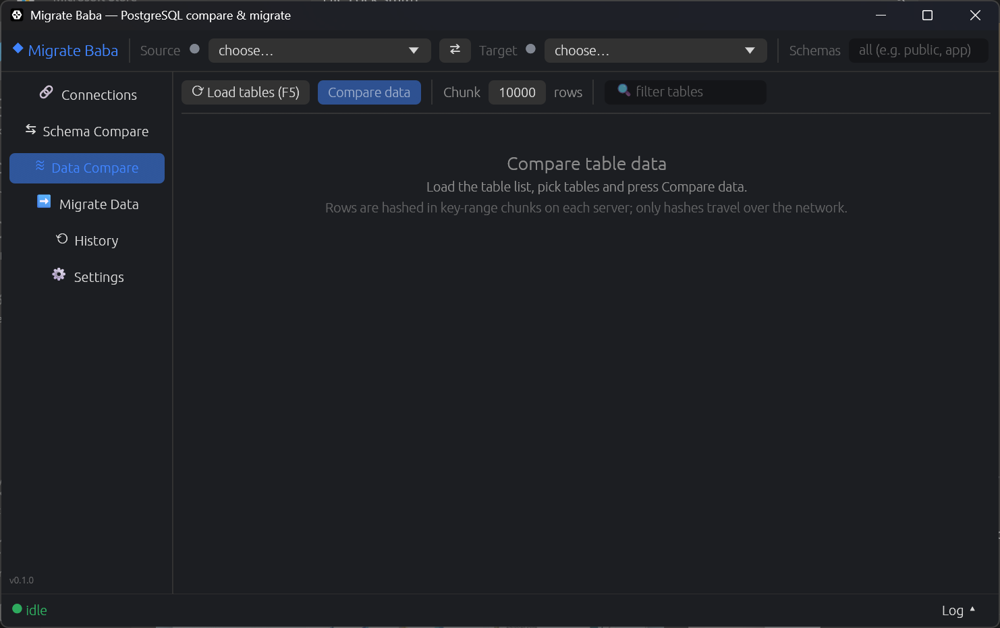
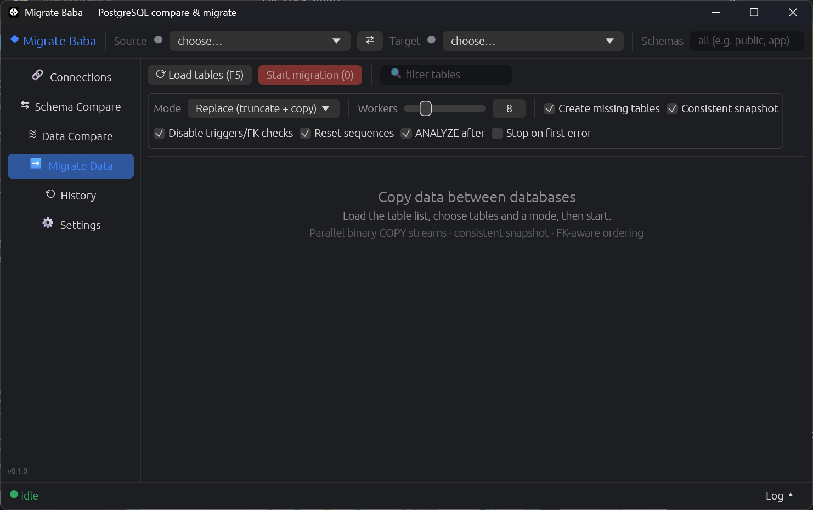
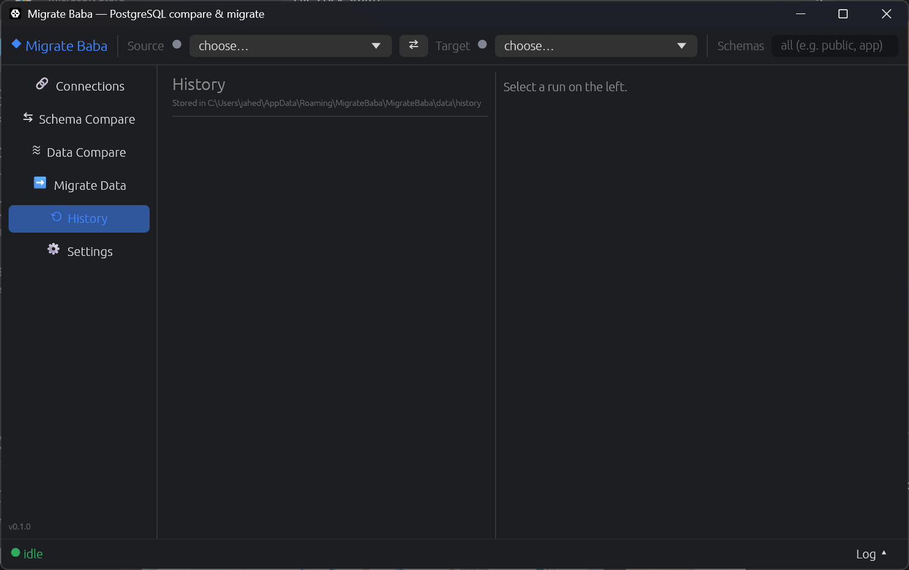
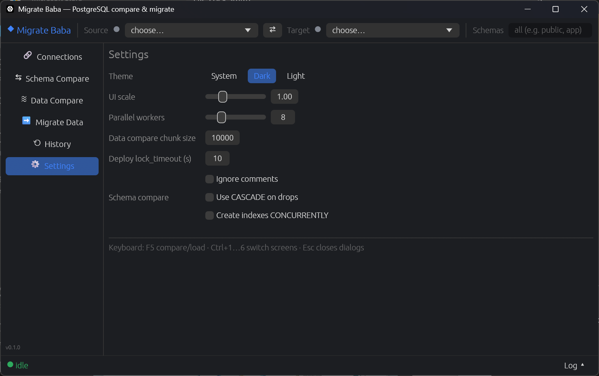

# Migrate Baba

Native Rust desktop app (Windows / macOS / Linux) to **compare, diff and migrate PostgreSQL databases** —
Supabase, Neon, AWS RDS/Aurora, Cloud SQL, Azure, DigitalOcean, Render, Railway, Crunchy Bridge, Timescale,
self-hosted (PostgreSQL 12+).

* **Schema Compare** — tables, columns, constraints, indexes, triggers, RLS policies, views & materialized
  views, functions/procedures (Supabase RPC), enums/domains/composite types, sequences, extensions, schemas,
  comments. Side-by-side DDL diff, per-object selection, dependency-ordered script with hazard annotations,
  **test deploy** (transaction + rollback) and deploy with stale-compare guard.
* **Data Compare** — server-side chunk hashing (only hashes cross the network), row-level drill-down,
  sync (upsert + delete via staging table).
* **Migrate Data** — parallel binary `COPY` streaming, exported snapshot for consistency, ctid splitting of
  big tables (PG14+), FK-ordered waves when triggers can't be disabled, sequence reset, ANALYZE.
* Passwords in the OS keychain; history of every deploy/copy/sync.
* `mbaba` CLI for CI (exit code 2 = drift found).

Specs live in [`docs/specs/`](docs/specs/00-overview.md).

## Layout

```
crates/mb-core   engine: connections, introspection, diff, plan, deploy, data copy/compare/sync
crates/mb-app    egui desktop app (binary: mb-app)
crates/mb-cli    command line (binary: mbaba)
```

## Build

Rust stable (1.85+).

* **Windows (GNU toolchain, as set up on this machine):** needs MinGW-w64 on `PATH`
  (e.g. `winget install BrechtSanders.WinLibs.POSIX.UCRT`). In Git Bash: `source env.sh`.
  With the MSVC toolchain + Visual Studio Build Tools nothing extra is needed.
* **macOS / Linux:** no extra setup.

```bash
cargo run -p mb-app --release        # desktop app
cargo run -p mb-cli -- --help        # CLI
cargo test -p mb-core                # unit + planner tests
```

## How to use

> Screenshots show each screen before any database is connected.

The workflow is always: **connect → pick Source and Target → compare → review → apply**.
*Source* is the database that already looks the way you want; *Target* is the one that will be changed.

### 1. Add your connections


1. Open **Connections** (`Ctrl+1`).
2. Paste a connection URL into the top field and press **Fill from URL**, or fill in the form by hand.
   - **Supabase:** choose the *Supabase* provider so its managed schemas (`auth`, `storage`, `realtime`, …)
     are excluded. Use the direct connection (`db.<ref>.supabase.co:5432`) or the session pooler
     (port `5432`), **not** the transaction pooler on port `6543`.
   - Most cloud providers need **SSL mode** `require`.
3. Press **Test connection**. It shows the server version, round-trip latency and whether the user can
   disable triggers for fast loads.
4. Press **Save**. The password goes to the Windows Credential Manager / macOS Keychain, never to disk.
   Tick **Production** on live databases to get extra confirmation before any write.
5. Press **Use as source** / **Use as target**, or pick them in the top bar. **⇄** swaps them.

Optional: type schema names into **Schemas** in the top bar (e.g. `public, app`) to limit everything to
those schemas.

### 2. Compare and migrate the schema



1. Open **Schema Compare** (`Ctrl+2`) and press **Compare** (`F5`).
2. The left list groups objects into **To create** (only in source), **To alter** (different) and
   **To drop** (only in target). Use the search box, the kind filter and **Show identical** to narrow it.
3. Click an object to see its definition in both databases **side by side** (green = added, red = removed,
   amber = changed). The **Changes** tab lists each difference in plain words.
4. Untick anything you don't want to apply. The **Script** tab shows the exact SQL for your selection, in
   dependency order, with risky statements labelled `DATA LOSS`, `REWRITE`, `MAY FAIL`, `LOCKS` or `MANUAL`.
5. Press **Test deploy** first: it runs the whole script inside a transaction and rolls it back, so you find
   errors without changing anything.
6. Press **Deploy…** to apply it. Scripts that can lose data, or targets tagged Production, ask you to
   type the database name. Afterwards the app re-compares automatically; the list should be empty.
   You can also **Copy SQL**, **Save .sql…**, or **Save as migration…** (timestamped file that works with
   the Supabase CLI) instead of deploying from the app.

`Options ▾` controls ignoring comments, `CASCADE` on drops and building indexes `CONCURRENTLY`.

### 3. Compare data



1. Open **Data Compare** (`Ctrl+3`), press **Load tables** (`F5`), tick the tables to check.
2. Press **Compare data**. Each table shows source/target row counts and how many rows exist only in the
   source, only in the target, or differ. Click a row to see sample keys.
3. **Sync to target…** makes the selected tables match the source: it inserts, updates and deletes only
   the rows in chunks that differ.

**Chunk** sets how many rows are hashed per round trip (default 10 000).

### 4. Copy data



1. Open **Migrate Data** (`Ctrl+4`) and press **Load tables** (`F5`). Tables missing on the target are
   marked **new**.
2. Choose a **Mode**:
   - **Replace**: empties the selected target tables, then copies everything.
   - **Append**: only inserts rows.
   - **Sync**: upserts and deletes so tables match. Needs a primary key.
3. Adjust **Workers** (parallel connections) and options. *Create missing tables* builds absent tables
   from the source schema first. *Consistent snapshot* copies all tables as of the same moment.
4. Press **Start migration** and confirm. Per-table progress, overall MB/s and ETA update live; **Cancel**
   stops cleanly.

### 5. History and settings



Every deploy, data copy and sync is stored in **History** (`Ctrl+5`) with its script, outcome and log.



**Settings** (`Ctrl+6`) controls the theme, UI scale, default workers, data-compare chunk size, the deploy
`lock_timeout` and schema-compare defaults.

### Troubleshooting

- **App closes immediately on start:** a graphics-driver problem. In PowerShell, run
  `$env:WGPU_BACKEND="gl"` and then start the app from that same window.
- **"target schema changed since the last compare":** someone changed the target; press Compare again.
- **Loads are slow / FK errors during copy:** the target user can't disable triggers (non-superuser, as on
  Supabase), so tables load in foreign-key order. That's expected.
- The **Log ▴** button in the bottom-right corner shows every action and full error details.

## CLI examples

```bash
mbaba diff --source "$STAGING_URL" --target "$PROD_URL" --supabase --out migration.sql
mbaba apply --target "$PROD_URL" --file migration.sql --dry-run
mbaba copy --source "$OLD_URL" --target "$NEW_URL" --mode replace --workers 8
mbaba data-diff --source "$A" --target "$B" --tables public.users,public.orders
```
