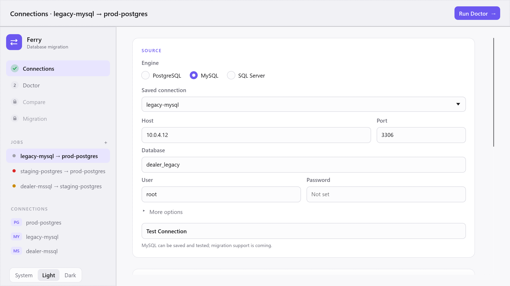
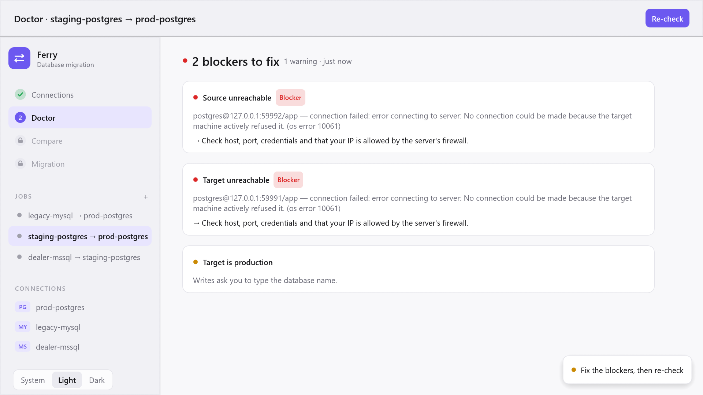
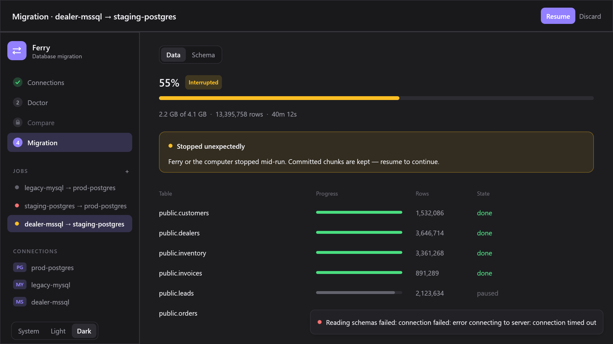

# Ferry (Migrate Baba)

Native Rust desktop app (Windows / macOS / Linux) to **check, compare and migrate PostgreSQL databases** —
Supabase, Neon, AWS RDS/Aurora, Cloud SQL, Azure, DigitalOcean, Render, Railway, Crunchy Bridge, Timescale,
self-hosted (PostgreSQL 12+). MySQL and SQL Server connections can be saved and reachability-tested; migrating
them is not implemented yet, and Doctor blocks such pairs.

* **Connections** — saved local/cloud connections, picked per job as *Source* and *Target*. Passwords live in
  the OS keychain.
* **Doctor** — pre-flight checks (reachability, versions, read/write/CREATE privileges, extensions, encodings,
  connection headroom, resume support) with copyable fixes. Blockers lock Compare and Migration.
* **Compare** — schema objects side by side, and chunk-hashed table data (only hashes cross the network).
* **Migration** — *Data*: parallel binary `COPY` in a background process that keeps running when the window
  closes, checkpoints every committed chunk, and pauses (never fails) on obstacles with a hint on what to fix.
  *Schema*: tables, views, functions, procedures, triggers, types — dependency-ordered script, test deploy,
  single-transaction deploy with a stale-target guard.
* `mbaba` CLI for CI (exit code 2 = drift found).

Specs live in [`docs/specs/`](docs/specs/00-overview.md) (written for the earlier screen layout).

## Layout

```
crates/mb-core   engine: connections, introspection, diff, plan, deploy, data copy/compare/sync
crates/mb-app    egui desktop app (binary: mb-app)
crates/mb-cli    command line (binary: mbaba)
```

## Build

Rust stable (1.85+).

* **Windows (GNU toolchain, as set up on this machine):** needs MinGW-w64 on `PATH`
  (e.g. `winget install BrechtSanders.WinLibs.POSIX.UCRT`). In Git Bash: `source env.sh`.
  With the MSVC toolchain + Visual Studio Build Tools nothing extra is needed.
* **macOS / Linux:** no extra setup.

```bash
cargo run -p mb-app --release        # desktop app
cargo run -p mb-cli -- --help        # CLI
cargo test -p mb-core                # unit + planner tests
```

## How to use

The sidebar walks through four steps; each unlocks the next. A **job** (sidebar → *Jobs*, `+` for a new one)
is one Source → Target pair with its own checks and runs. `Ctrl+1…4` jump between steps.

### 1. Connections



Pick the engine, then a saved connection or **＋ New connection**, for both Source (the database that already
looks right) and Target (the one that changes). Fields save themselves when you leave them; **Test Connection**
checks the server. *More options* holds the name, provider preset (sets SSL and skipped schemas, e.g. Supabase's
managed schemas), SSL mode, a paste-a-URL field and the *Production* flag (writes then ask you to type the
database name). Right-click a connection in the sidebar to use it as source/target or delete it.

### 2. Doctor



Runs every pre-flight check. **Blockers** must be fixed before Compare and Migration unlock — most come with
the exact `GRANT` to run. Warnings don't block. Changing either connection invalidates the result.

### 3. Compare

*Schema*: objects grouped into new / changed / only-in-target with a side-by-side definition diff.
*Data*: per-table row counts and missing / extra / changed rows.

### 4. Migration



**Data** — pick tables and a mode (*Replace* empties target tables first, *Append* only inserts, *Sync* upserts
and deletes; needs a primary key), then **Run Migration**.

- The copy runs in a separate background process, so closing Ferry doesn't stop it; reopen Ferry to see live
  progress. The computer is kept awake while it runs (Windows).
- **Pause** / **Resume** at any time. If the app, the worker or the computer stops mid-run, the job shows
  *Interrupted* and **Resume** continues from the last committed chunk.
- Any obstacle (lost connection, permissions, duplicate keys, full disk…) pauses the run and says what to fix.
  Fix it, then **Resume**.
- Exact resume uses a small marker table in schema `_mbaba` on the target, written in the same transaction as
  each chunk and removed when the job finishes or is discarded. Without `CREATE` rights resume still works from
  the local checkpoint (Doctor warns that a crash mid-chunk may re-copy that chunk).

**Schema** — tick the objects to apply, review the generated script and hazard labels, **Test** (runs in a
transaction and rolls back), then **Deploy**.

### Data on disk

Connections and settings live in the user config folder, jobs in `<data>/jobs/<id>/` (`job.json`, `run.json`
with progress + checkpoint, `log.txt`). Set `FERRY_HOME` to keep everything in one folder instead.

### Troubleshooting

- **App closes immediately on start:** Ferry renders with OpenGL on Windows and relaunches itself on DX12 if that
  fails. To force one, set `$env:WGPU_BACKEND="dx12"` (or `"gl"`) and start the app from that window.
- **"The target changed since it was read":** someone changed the target; press Refresh in Compare.
- **Slow loads / FK errors:** the target user can't pause triggers (non-superuser, e.g. Supabase), so tables load
  in foreign-key order. Doctor reports this as *Foreign-key ordered load*.

## CLI examples

```bash
mbaba diff --source "$STAGING_URL" --target "$PROD_URL" --supabase --out migration.sql
mbaba apply --target "$PROD_URL" --file migration.sql --dry-run
mbaba copy --source "$OLD_URL" --target "$NEW_URL" --mode replace --workers 8
mbaba data-diff --source "$A" --target "$B" --tables public.users,public.orders
```
